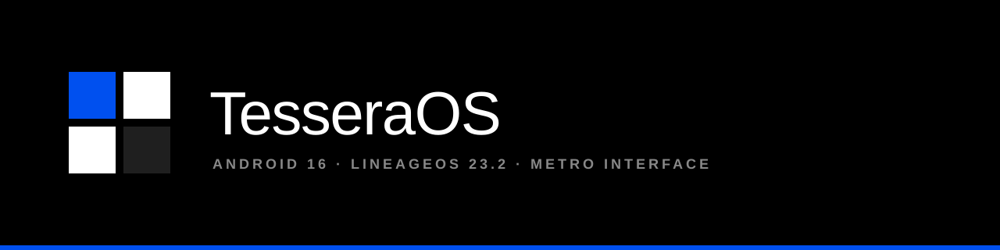

<p align="center">
  
</p>

TesseraOS is an Android 16 distribution based on [LineageOS 23.2](https://github.com/LineageOS), designed around a native Metro-inspired system interface, dynamic system-wide accent theming, and [Selawik](https://github.com/microsoft/Selawik) typography.

## Core Repositories

| Repository | Branch | Description |
| :--- | :--- | :--- |
| [android](https://github.com/TesseraOS-Android/android) | `16.0` | Standalone AOSP/LineageOS source manifest |
| [android_frameworks_base](https://github.com/TesseraOS-Android/android_frameworks_base) | `16.0` | SystemUI, SettingsLib, Status Bar, Action Center, and dynamic accent engine |
| [android_packages_apps_Settings](https://github.com/TesseraOS-Android/android_packages_apps_Settings) | `16.0` | Metro Pivot homepage, pure black subpages, and rectangular system controls |
| [android_packages_apps_TesseraHome](https://github.com/TesseraOS-Android/android_packages_apps_TesseraHome) | `16.0` | Native privileged Start Screen and Live Tiles launcher |
| [android_vendor_tessera](https://github.com/TesseraOS-Android/android_vendor_tessera) | `16.0` | Product configuration, Selawik fonts, privileged permissions, and RRO overlays |

## Getting Started

```bash
repo init -u https://github.com/TesseraOS-Android/android.git -b 16.0 --git-lfs
repo sync -c --no-clone-bundle --optimized-fetch --prune
```

```bash
source build/envsetup.sh
lunch tessera_<device>-bp4a-userdebug
mka bacon
```

## Supported Devices

| Device | Codename | Branch | Status |
| :--- | :--- | :--- | :--- |
| Nothing Phone (1) | `Spacewar` | `16.0` | Active |

## Credits

- [Android Open Source Project (AOSP)](https://android.googlesource.com)
- [LineageOS Project](https://github.com/LineageOS)
- [TheMuppets](https://github.com/TheMuppets)
- [Microsoft Selawik Font (MIT)](https://github.com/microsoft/Selawik)